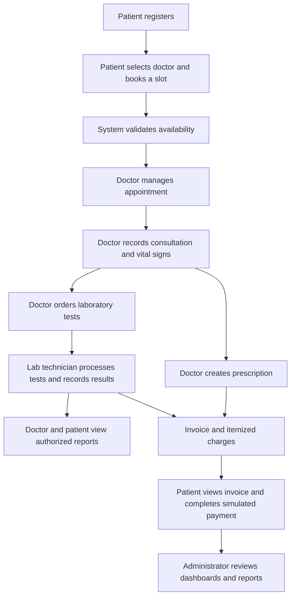

# HeartCare Clinic Management System

A web-based clinic management system designed to connect patients, doctors, laboratory technicians, and clinic administrators through one shared MySQL database.

> **Project type:** Web Technologies semester project  
> **Repository:** `heartcare-clinic-management-system`  
> **Development status:** Academic project in development

## Overview

HeartCare aims to digitize the core workflow of a heart-care clinic, from patient registration and appointment booking to consultations, prescriptions, laboratory investigations, billing, and administrative reporting.

Rather than building four separate applications, HeartCare uses one connected platform with role-specific dashboards and permissions. Records created in one module become available to the other authorized users through linked database relationships.

For example, when a patient books an appointment, the doctor can manage that booking. After the consultation, the doctor can create a prescription and order laboratory tests. The laboratory technician records the results, the patient and doctor can view the completed report, and the system can generate an invoice. Administrators can monitor clinic activity through reports and dashboards.

## Objectives

- Build a centralized clinic management platform with four user roles.
- Demonstrate CRUD operations and relational database design.
- Implement authentication, session management, role-based authorization, and server-side validation.
- Connect appointments, consultations, prescriptions, laboratory orders, results, invoices, and payments.
- Add practical features beyond basic CRUD, including reporting, charts, printable documents, and automated validation.
- Practice collaborative development, version control, integration, and testing.

## Technology Stack

| Technology | Purpose |
|---|---|
| HTML5 | Page structure and forms |
| CSS3 | Responsive interface and print layouts |
| JavaScript | Client-side interactions and appointment-slot UI |
| PHP (procedural) | Server-side logic, validation, sessions, and workflows |
| MySQL | Shared relational database |
| MySQLi prepared statements | Database access and safer handling of user input |
| Apache / XAMPP | Local development environment |
| Chart.js | Dashboard charts and health-trend visualization |

The project is intended to use **procedural PHP**, not an object-oriented PHP architecture or a PHP framework.

## User Roles and Features

### 1. Administrator

Manages clinic configuration and monitors operations across the platform.

**Core functionality**
- Manage departments, doctors, laboratory technicians, user accounts, and test definitions.
- View and monitor clinic appointments.
- Activate or deactivate accounts and catalogue entries while preserving historical records.

**Planned features beyond CRUD**
- **Analytics dashboard:** patient counts, active doctors, today's appointments, monthly collected revenue, and charts.
- **Monthly report generator:** appointment and consultation summaries, revenue reports, busiest doctors, and commonly ordered tests, with print-to-PDF support.
- **Audit log viewer:** searchable activity history with date, user, and action filters.

### 2. Doctor

Manages appointments and records clinical information for assigned patients.

**Core functionality**
- Manage availability and schedules.
- Confirm, cancel, and complete assigned appointments.
- Record consultations, clinical notes, and relevant vital signs.
- Create prescriptions and order laboratory investigations.
- Review authorized patient history and test results.

**Planned features beyond CRUD**
- **Heart-health screening demonstration:** a transparent, rule-based educational calculation with a clear non-diagnostic disclaimer.
- **Printable prescriptions:** generate print-ready prescriptions from saved consultation and prescription records.
- **Patient medical timeline:** view consultations, prescriptions, test orders, results, and historical measurements, including trend charts.

### 3. Patient

Uses a self-service portal to manage appointments and view their own clinic records.

**Core functionality**
- Register and manage permitted profile details.
- Search for doctors and book, reschedule, or cancel appointments.
- Record eligible personal health measurements.
- View their own prescriptions, laboratory reports, invoices, and payment records.

**Planned features beyond CRUD**
- **Smart appointment booking:** display available time slots and validate booking conflicts on the server.
- **Invoices and simulated payments:** view itemized charges, complete a mock checkout, and print a receipt.
- **Personal health tracker:** visualize measurements such as blood pressure, weight, and blood glucose over time.

### 4. Laboratory Technician

Processes doctor-ordered tests and records laboratory results.

**Core functionality**
- View and filter the laboratory order queue.
- Update order statuses through the defined workflow.
- Record and manage permitted test results.
- View test definitions and configured reference ranges.
- Generate reports for authorized laboratory orders.

**Planned features beyond CRUD**
- **Automated lab queue:** new doctor orders appear in the queue and can be filtered by status or date.
- **Reference-range flagging:** numeric results can be marked `LOW`, `NORMAL`, or `HIGH` against configured ranges.
- **Printable laboratory reports:** generate reports linked to their original test orders and results.

## Connected Workflow



The goal is to keep these as linked records in one database, rather than separate pages containing duplicated or disconnected information.

## Planned Database Design

The logical database is expected to include the following core tables. Exact columns, constraints, indexes, and relationships will be finalized during implementation.

| Table | Purpose |
|---|---|
| `users` | Shared login identity, password hash, role, and account status |
| `patients` | Patient-specific profile information |
| `doctors` | Doctor profile, department, and consultation fee |
| `lab_technicians` | Laboratory technician profiles |
| `departments` | Clinic departments |
| `doctor_schedules` | Doctor availability and appointment-slot rules |
| `appointments` | Patient bookings, doctor assignment, date, time, and status |
| `consultations` | Clinical records linked to appointments |
| `prescriptions` | Prescription header and advice |
| `prescription_items` | Medicine instructions within a prescription |
| `test_types` | Test catalogue, prices, units, and configured reference ranges |
| `lab_orders` | Tests ordered during a consultation |
| `lab_results` | Results and relevant reporting details |
| `health_logs` | Patient-entered measurements over time |
| `invoices` | Bills and overall invoice status |
| `invoice_items` | Itemized consultation and laboratory charges |
| `payment_methods` | Mock or tokenized payment-method references |
| `payments` | Payment status and transaction reference |
| `audit_logs` | Important user actions and record changes |

Foreign keys should connect these records. For example, an appointment references a patient and a doctor, a consultation references an appointment, and laboratory results reference laboratory orders.

## Project Structure

The following is the proposed structure. Directories and filenames may change as development progresses.

```text
heartcare-clinic-management-system/
├── README.md
├── database/
│   ├── schema.sql
│   ├── seed_data.sql
│   └── er_diagram.png
├── config/
│   └── db.php
├── includes/
│   ├── auth.php
│   ├── functions.php
│   ├── csrf.php
│   ├── header.php
│   ├── footer.php
│   └── sidebar.php
├── assets/
│   ├── css/
│   ├── js/
│   └── images/
├── auth/
│   ├── login.php
│   ├── register.php
│   └── logout.php
├── admin/
├── doctor/
├── patient/
├── lab/
└── index.php
```

- `database/` will contain the database schema, sample data, and ER diagram.
- `config/db.php` will provide the shared MySQL connection.
- `includes/` will contain reusable authentication, validation, CSRF, and layout files.
- `auth/` will handle registration, login, and logout.
- `admin/`, `doctor/`, `patient/`, and `lab/` will contain role-specific pages.
- `assets/` will contain stylesheets, JavaScript, and images.

## Getting Started

### Requirements

- Windows, Linux, or macOS
- [XAMPP](https://www.apachefriends.org/) with Apache, PHP, and MySQL/MariaDB
- A modern web browser
- A code editor such as Visual Studio Code
- Git (recommended for team development)

### Local Setup with XAMPP

1. **Get the project.** Clone the repository or download it, then place the project folder inside XAMPP's `htdocs` directory. For example:

   ```text
   C:\xampp\htdocs\heartcare-clinic-management-system
   ```

2. **Start the services.** Open the XAMPP Control Panel and start **Apache** and **MySQL**.

3. **Create the database.** Open [phpMyAdmin](http://localhost/phpmyadmin/), create a database named `heartcare_db`, and import `database/schema.sql` when that file is available.

4. **Load sample data.** Import `database/seed_data.sql` if it is included. Use only the project's synthetic demonstration accounts and data.

5. **Configure the connection.** Set the local database host, database name, username, and password in `config/db.php`. A typical local XAMPP setup uses host `localhost`, username `root`, and an empty password, unless your installation is configured differently. Do not commit private credentials to GitHub.

6. **Open the application.** Once the entry point is implemented, visit:

   ```text
   http://localhost/heartcare-clinic-management-system/
   ```

7. **Sign in.** Use the demo credentials documented alongside the seed data, if available. Change or remove any sample credentials before deploying the application anywhere public.

> **Development note:** Setup steps that depend on `schema.sql`, `seed_data.sql`, or individual PHP pages will work only after those files have been added to the repository.

## Security and Privacy Considerations

Because the application represents a healthcare workflow, security and record integrity are core requirements.

- Store passwords using PHP's `password_hash()` and verify them with `password_verify()`.
- Use procedural MySQLi prepared statements for queries that include user input.
- Validate data on the server, even when client-side JavaScript validation is used.
- Escape output with `htmlspecialchars()` where appropriate.
- Enforce role checks and record ownership on every protected server-side request. Hiding a link or button is not authorization.
- Use CSRF tokens for state-changing forms and regenerate session IDs after login.
- Use database foreign keys and transactions for operations that must succeed or fail together.
- Prevent duplicate appointment bookings through server-side checks and database constraints.
- Preserve relevant medical and financial history instead of physically deleting referenced records.
- Never store raw payment-card numbers, CVVs, or expiry details. Payments in this academic project are simulated.
- Never commit real patient data, passwords, API keys, or database secrets.

## Medical and Project Limitations

HeartCare is an **academic prototype**, not a certified clinical system or production-ready payment platform.

- Use synthetic patient data for development, screenshots, and demonstrations.
- Laboratory flags depend on the configured test ranges and are informational; they do not establish a diagnosis.
- The proposed heart-health screening calculation is an educational programming demonstration, not a validated clinical risk model. It must not be used to diagnose a patient or recommend treatment.
- Payment processing is simulated; no real money is collected.
- Production deployment would require additional security, privacy, clinical validation, operational, and regulatory work.

## Team Responsibilities

The project is designed for a four-member team, with each member owning one primary role module.

| Team role | Primary responsibility |
|---|---|
| Member 1 | Administrator, clinic configuration, analytics, reports, and audit logs |
| Member 2 | Doctor schedules, appointments, consultations, prescriptions, and test orders |
| Member 3 | Patient portal, appointment booking, health logs, invoices, and simulated payments |
| Member 4 | Laboratory queue, result entry, reference-range flags, and laboratory reports |

All members should collaborate on the shared database schema, authentication and authorization, common interface, coding conventions, integration testing, and documentation. Agree on table names, relationships, status values, and shared PHP functions before implementing separate modules.

## Development Roadmap

The development priority is to get the connected workflow working before polishing advanced dashboards.

1. Finalize scope, database relationships, ER diagram, and repository conventions.
2. Implement database connection, authentication, sessions, role checks, and shared layouts.
3. Build the CRUD operations for the four role modules.
4. Connect appointment scheduling and enforce duplicate-booking prevention.
5. Implement consultations, prescriptions, and laboratory orders.
6. Add the laboratory queue, results, and printable reports.
7. Add invoices, simulated payments, and patient health logs.
8. Build the advanced features: charts, monthly reports, medical timeline, and audit log.
9. Test permissions, validation, transactions, error cases, and cross-module workflows.
10. Prepare screenshots, synthetic demo data, documentation, and the final presentation.

## Testing Checklist

Before the final demonstration, verify that:

- A patient can book an available slot, and conflicting bookings are rejected.
- A patient cannot view another patient's records or invoice.
- A doctor cannot modify appointments outside their permitted scope.
- A completed consultation remains linked to its appointment.
- A doctor's laboratory order appears in the laboratory queue.
- A laboratory result is linked to the correct order and uses the configured reference range.
- Only authorized users can view a prescription or laboratory report.
- A patient cannot edit doctor-authored consultations or prescriptions.
- Failed payment processing does not leave an invoice incorrectly marked as paid.
- Unpaid invoices are excluded from collected-revenue reporting.
- Inactive doctors cannot receive new appointments.
- SQL input, invalid form data, and unauthorized requests are handled safely.
- Logged-out users cannot access protected pages.

## Contributing

This is a collaborative academic project. Team members should:

1. Work on clearly scoped feature branches.
2. Make small, meaningful commits.
3. Keep database schema changes and sample data scripts in version control.
4. Avoid committing generated files, secrets, or real personal data.
5. Test module integration regularly instead of waiting until the end of the semester.

## License

This project is being developed for academic purposes. A license has not yet been specified.

---

**HeartCare Clinic Management System** — connecting clinic operations through one shared, role-based web application.
