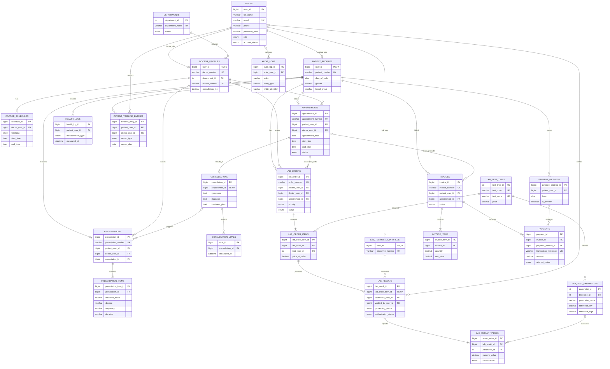

# HeartCare Proposed ERD

## Relationship notes

- Each patient, doctor, or lab technician is an account in `users` plus a one-to-one profile. The admin role needs no extra profile table.
- Appointments are shared records. Patient and doctor pages scope the same row; department is derived from the doctor’s department.
- A consultation is uniquely associated with an appointment. Vitals are separate readings because they can be repeated and have different units.
- Prescriptions contain multiple medicine rows. Their demographic display fields come from the patient profile, not copied into every prescription.
- Lab orders contain one or more order items. Results and measured values are separate so a panel can return multiple parameters and preserve the exact reference range used at reporting.
- Invoice items and payment attempts remain separate. Invoice totals and balances are calculated from item and successful-payment rows.
- Audit target references are polymorphic; `entity_type` and `entity_identifier` identify targets without pretending a single FK can point to multiple tables.
- There is no screening relationship in this ERD because the referenced frontend route and calculator are absent.
